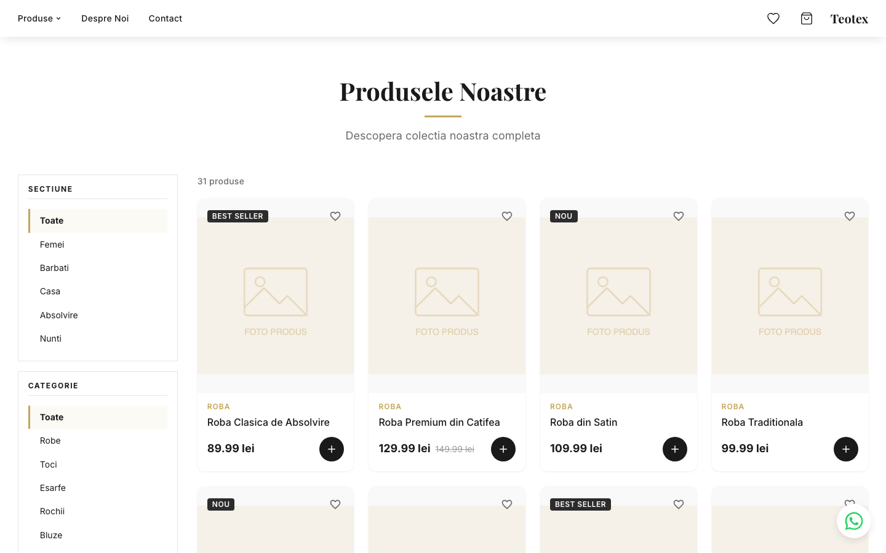

# TeoTex — Articole textile pentru orice ocazie

Site de prezentare și e-commerce pentru **TeoTex**, un atelier românesc cu peste 10 ani de experiență în confecționarea și vânzarea de articole textile. Catalogul acoperă cinci secțiuni mari: îmbrăcăminte pentru femei, îmbrăcăminte pentru bărbați, textile pentru casă, articole de absolvire (robe, toci, eșarfe) și ținute pentru nuntă (rochii de mireasă, costume de mire). Interfața este integral în limba română, iar prețurile sunt afișate în RON (lei).



*Pozele de produs sunt încă imagini de test.*

## Stack tehnic

- **React 19** + **TypeScript** (strict)
- **Vite** pentru bundling și dev server
- **React Router 7** (`HashRouter`) pentru navigare client-side
- **CSS Modules** pentru stilizare la nivel de componentă
- **vite-plugin-singlefile** — output-ul de producție este un singur `index.html` cu JS și CSS inline, care se poate deschide direct cu dublu-click sau servi de pe orice host static

## Funcționalități

- **Catalog împărțit în 5 secțiuni** (Femei, Bărbați, Casă, Absolvire, Nunți), cu sub-categorii (rochie, bluză, fustă, cămașă, costum, pijama, perdea, lenjerie, robă, tocă, eșarfă, rochie mireasă, costum mire).
- **Navigare cu dropdown** pentru "Produse" în navbar (deschidere doar la click, închidere pe Esc / outside-click / selecție); pe mobil dropdown-ul devine listă plată în meniul hamburger.
- **Filtrare avansată în sidebar pe stânga** pe pagina Produse — casete pătrate cu filtre pentru secțiune, sub-categorie, preț (min/max), sortare (recomandate / preț ↑↓ / cele mai noi) și disponibilitate (doar produse în stoc). Pe mobil filtrele se ascund în spatele unui buton `Filtre (N)`.
- **Coș de cumpărături** la `/#/cos` — listă produse cu controale de cantitate (`+`/`−`), total pe rând, ștergere item, sumar comandă lipicios cu Total + două CTA-uri (WhatsApp cu mesaj pre-completat conținând lista + cantități + total, și `tel:` pentru apel direct), plus stare goală cu CTA. Comenzile se finalizează exclusiv prin WhatsApp / telefon — nu există plată online sau livrare automată.
- **Listă de favorite** la `/#/favorite` — grid de produse, sincronizat cu inima din cardurile de produs.
- **Iconițe coș + favorite în navbar** cu badge-uri care afișează numărul de produse, identice ca stil.
- **Buton flotant WhatsApp** vizibil pe orice pagină, conectat la numărul magazinului.
- **Harta Google Maps** integrată pe pagina Contact (iframe cu `output=embed`, fără API key) — caută "TeoTex Fashion SRL, Stroiești".
- **Scroll la top automat** la orice navigare, inclusiv click pe Link către pagina curentă (depinde de `location.key`), implementat în `src/components/ui/ScrollToTop.tsx`.
- **Navbar sticky compact** (`--navbar-height: 60px`) cu shadow soft, care plutește deasupra paginii.
- **Hero extins** pe pagina principală — panoul crem (`--color-bg-primary`) ocupă ~88vh pe desktop / 65vh pe mobil, ca să domine prima vizualizare.
- **Layout edge-to-edge complet adaptiv** — navbar, `Container` și `Footer` folosesc același `padding: clamp(16px, 2vw, 32px)`, deci conținutul se aliniază la marginile ecranului pe orice dimensiune și la orice zoom. `--max-width: none` în `tokens.css` lasă layout-ul să folosească toată lățimea disponibilă.
- **Routing pe URL share-abil** — secțiunea curentă se păstrează în query (`?sectiune=femei` etc.), deci link-urile pot fi salvate / trimise.

## Rute

| URL (hash) | Pagină |
|---|---|
| `/` | Pagina principală |
| `/produse` | Toate produsele |
| `/produse?sectiune=femei` | Produsele din secțiunea Femei |
| `/produse?sectiune=barbati` | Bărbați |
| `/produse?sectiune=casa` | Textile pentru casă |
| `/produse?sectiune=absolvire` | Articole de absolvire |
| `/produse?sectiune=nunti` | Articole de nuntă |
| `/despre-noi` | Despre noi |
| `/contact` | Contact (formular + date + WhatsApp + hartă Google Maps) |
| `/cos` | Coșul de cumpărături |
| `/favorite` | Lista de favorite |

Orice altă rută trimite la pagina 404.

## Structura proiectului

```
src/
├── App.tsx                       # rutare top-level (HashRouter, ScrollToTop, providers)
├── main.tsx                      # entry point
├── components/
│   ├── home/                     # secțiuni de pe pagina principală (FeaturedProducts etc.)
│   ├── layout/                   # Navbar (cu dropdown), Footer, Layout
│   ├── product/                  # ProductCard, ProductFilter (sidebar), ProductGrid
│   └── ui/                       # Button, Container, WhatsAppButton, ScrollToTop, ...
├── context/                      # CartContext, WishlistContext (state global, in-memory)
├── data/products.ts              # catalogul static de produse
├── hooks/                        # useCart, useWishlist
├── pages/                        # Home, Products, About, Contact, Cart, Favorite, NotFound
├── styles/                       # global.css, reset.css, tokens.css (variabile de design)
└── types/                        # tipuri TypeScript (Product, Cart, ProductSection, ProductCategory)
```

## Rulare locală

Cerințe: Node.js 20+ și npm.

```bash
npm install
npm run dev
```

Vite pornește dev server-ul (de obicei pe `http://localhost:5173`) cu hot module reload.

### Comenzi disponibile

| Comandă | Ce face |
|---|---|
| `npm run dev` | Pornește dev server-ul Vite cu HMR |
| `npm run build` | Rulează `tsc -b` și apoi build de producție în `dist/` (un singur `index.html` self-contained) |
| `npm run preview` | Servește local build-ul din `dist/` pentru verificare |
| `npm run lint` | Rulează ESLint peste tot codul |

## Build și deploy

```bash
npm run build
```

După build, `dist/` conține:

- `index.html` — un singur fișier cu tot JavaScript-ul și CSS-ul inline (prin `vite-plugin-singlefile`)
- `assets/images/` — imagini de produs

Pentru a vizualiza site-ul fără un server web, se deschide `dist/index.html` direct în browser. Pentru hostare, se urcă conținutul folderului `dist/` pe orice host static (Vercel, Netlify, GitHub Pages, hosting clasic etc.).

> **Notă:** Rutarea folosește `HashRouter`, deci URL-urile au forma `/#/produse`, `/#/contact` etc. Asta permite ca site-ul să funcționeze de pe orice cale (inclusiv `file://`) fără configurare server-side. Dacă se trece în viitor la `BrowserRouter`, hostul trebuie configurat să facă fallback către `index.html` pentru toate rutele.

## Editare conținut

- **Produse:** `src/data/products.ts`. Fiecare produs are `section` (`FEMEI` / `BARBATI` / `CASA` / `ABSOLVIRE` / `NUNTI`) și `category` (sub-tipul). Tipurile sunt definite în `src/types/product.ts`.
- **Imagini produse:** se pun în `public/assets/images/` și se referențiază relativ ca `assets/images/<nume-fisier>` în `products.ts`.
- **Culori, tipografie, spațieri:** variabilele de design sunt centralizate în `src/styles/tokens.css`.
- **Date de contact:** `src/pages/ContactPage.tsx` (email, adresă, program, query pentru harta Google Maps).
- **Număr de telefon / WhatsApp:** se setează într-un singur loc, `src/config/contact.ts`, și e folosit de butonul flotant, pagina Contact și coș. Acum conține un număr de exemplu; trebuie înlocuit cu cel real înainte de lansare.
- **Texte despre brand:** `src/pages/AboutPage.tsx`.

## Limitări curente (de avut în vedere)

- Catalogul, coșul și lista de favorite sunt **doar pe client** — nu există backend sau persistență între sesiuni. Asta e prin design: comenzile se finalizează prin WhatsApp / telefon, nu prin checkout online.
- **Formularul de Contact e cosmetic** — `handleSubmit` doar afișează un mesaj de succes, nu trimite efectiv mesajul nicăieri. Următorul pas (în lucru): redirect pe WhatsApp sau email-relay via FormSubmit / Web3Forms.
- Imaginile de produs sunt placeholder SVG. De înlocuit cu fotografii reale înainte de lansare.
- Nu există încă pagini dedicate de produs (PDP) — cardul nu navighează la un detaliu separat.
- Nu există pagini legale (Termeni, Retur, GDPR, ANPC SAL, SOL) — necesare pentru e-commerce real în România.

## Licență

Cod proprietar. Toate drepturile rezervate © TeoTex.
